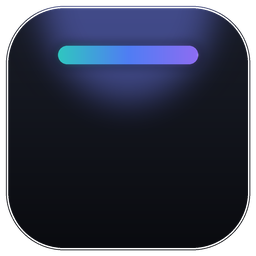
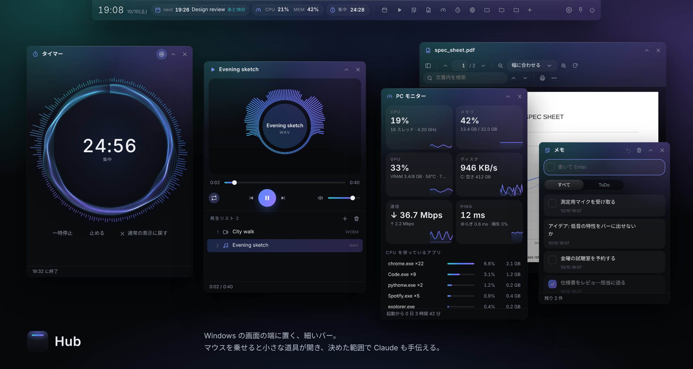
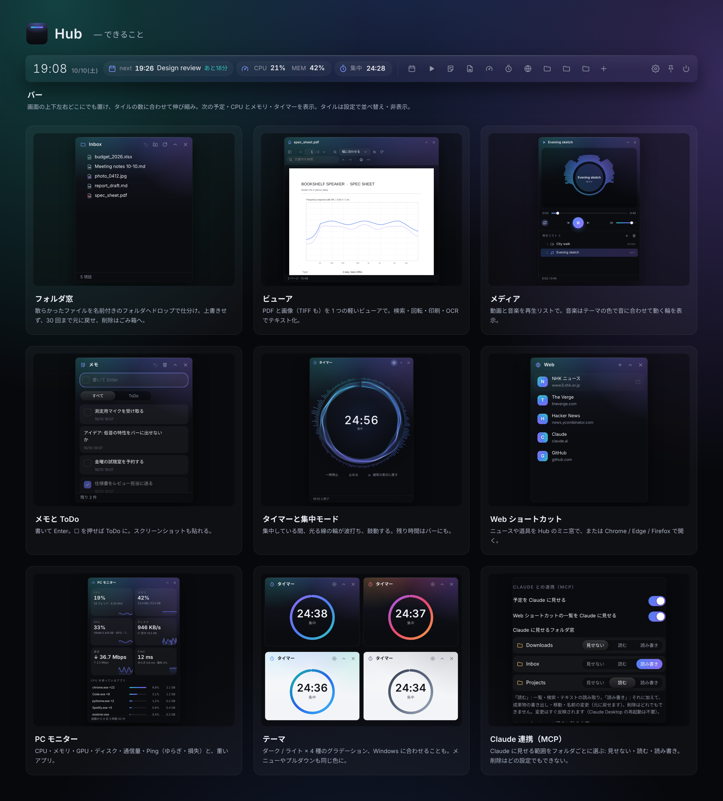

<p align="center"></p>

# Hub

<p align="center"><a href="README.md">English</a> · <b>日本語</b></p>

画面の端に細いバーとして常駐し、マウスを乗せると広がる、デスクトップの「作業台」です。
ファイルの仕分け・PDF と画像の閲覧・動画と音楽の再生・メモと ToDo・集中タイマー・よく見るサイト・PC の負荷・次の予定の確認を、アプリを切り替えずに済ませられます。



> ライセンス: [PolyForm Noncommercial 1.0.0](LICENSE) — 個人利用など、営利目的でなければ自由に使えます。

## できること




| 機能 | 内容 |
|---|---|
| **フォルダ窓** | デスクトップに散らばるファイルを、名前付きのフォルダ窓にドロップして仕分ける。上書きせず、30 回まで元に戻せる。削除はごみ箱へ |
| **ビューア** | PDF と**画像**（PNG / JPEG / GIF / WebP / BMP / **TIFF**。複数ページの TIFF も）を 1 つの軽いビューアで。サムネイル・拡大縮小・回転・検索・**印刷**・同じフォルダの写真を ← → で順に。「プログラムから開く」に登録できる。OCR でテキスト化、PDF の画像化（PNG / JPEG / TIFF G4）も。**メモ**: .md・.txt・.rtf を読みやすく表示（rtf は文字だけ）。「書く」で紙（無地・罫線・方眼）の上にそのまま打てて自動で保存、md には**写真**と**手書き**も入れられる（md の横の `<名前>_files` に保存）。フォルダ窓でダブルクリックするとここで開き、右クリック →「新しいメモ」ですぐ書ける。**Word / Excel / PowerPoint** も読むだけなら Office なしで: docx はページの形のまま表示、xlsx・pptx は LibreOffice（無料・任意）があれば見た目どおり、無ければ文字だけ |
| **メディア** | 動画と音楽を再生リストで（ファイルやフォルダごとドロップ）。音楽はテーマの色で音に合わせて動く輪を表示。そのまま再生できない形式（AVI・WMV・WMA など）は、**自分で入れた** ffmpeg で変換できる |
| **メモ** | メモと ToDo を 1 つに。書いて Enter、☐ を押してから書けば ToDo。スクリーンショットは Ctrl+V で貼れる |
| **タイマー** | 5 / 15 / 25 / 50 分をワンクリック（任意の分も可）。残り時間はバーに出て、終わると小さく鳴る。**フォーカスモード**ではリングが粒子になり、波打ちながら鼓動する |
| **Web** | よく見るサイト（ニュースなど）のショートカット。Hub のミニ窓か、Chrome / Edge（アドレスバーの無いアプリ窓）/ Firefox / いつものブラウザで開く |
| **PC モニター** | CPU・メモリ・NVIDIA の GPU（使用率・VRAM・温度）・ディスク・通信量・Ping（ゆらぎ・損失）と、重いアプリ。CPU とメモリはバーにも出せる |
| **予定** | Google / Outlook.com / iCloud のカレンダーを iCal URL で読み取り、バーに `next 14:00 定例 · あと12分` と表示（読み取り専用） |
| **Claude 連携（MCP）** | Claude に「Inbox の資料をまとめて Outbox に保存して」「明日の予定は？」などを頼める。見せるフォルダ窓は自分で選ぶ |
| **テーマ** | ダーク / ライト × 8 種のグラデーション（Aurora・Ocean・Ember・Graphite・Forest・Sakura・Gold・Indigo）、Windows に合わせることも可。メニューやプルダウンもテーマの色に合わせる |
| **設定** | 表示言語・テーマ・バーの位置（上下左右）・角丸・フォルダの場所を画面から変更 |

## はじめかた（3 ステップ）

1. **Python 3.14** を入れる（3.10 以上なら動きます。[python.org](https://www.python.org/downloads/) から。インストール時に「Add python.exe to PATH」にチェック）。
   拡張で使う道具には 3.15 用がまだ無いものがあるため、`start_hub.bat` は 3.14 が入っていれば 3.14 で起動します（先頭の `set HUB_PY=3.14`）。
2. このフォルダ（`hub`）を好きな場所に置き、フォルダの中でコマンドプロンプトを開いて次を実行する（管理者権限は不要）。
   ```bat
   py -3.14 -m pip install --user -r requirements.txt
   ```
3. `start_hub.bat` を**最初の 1 回だけ**ダブルクリックし、設定（⚙）→ 起動 →「スタートメニューに Hub を置く」を ON にします。以後はほかのアプリと同じように開けます。

設定ファイルを用意する必要はありません。初回起動時に、ユーザーフォルダの下へ **`Hub\Inbox`** が自動で作られ、
バーに「Inbox」のフォルダ窓が出ます（例: `C:\Users\あなた\Hub\Inbox`）。場所は **設定（バーの ⚙）** から変えられます。
起動すると、画面の端の光る線が伸びてバーが開くアニメーションが流れます（設定で OFF にできます）。

| やりたいこと | 方法 |
|---|---|
| 起動 | `start_hub.bat`（黒い画面は出ません） |
| うまく動かないとき | `start_hub_debug.bat` で起動するとエラーが表示されます。`%LOCALAPPDATA%\Hub\data\hub.log` にも記録されます |
| 画面共有やスクリーンショットに Hub が写らない | 拡張（レックスケッチ）が「画面も」で録音している間は、Hub の窓を画面の取り込みから外しています（会議の静止画に Hub が写り込まないように）。録音を止めると戻ります。Hub を見せながら画面共有したいときは「画面も」をオフにして録音します |
| 「入っていない」と言われる | 道具は **Hub を動かしている Python** に入れます（設定 →「このHubについて」に版が出ます）。`py` だけで入れると最新の Python（3.15 など）に入ってしまうので `py -3.14 -m pip install …` のように版を付けます。Python の版を変えたら、Claude 連携の設定（`claude_desktop_config.json`）も設定画面の「コピー」から貼り直します |
| 終了 | バーの右端の ⏻ |
| Windows 起動時に自動で立ち上げる | 設定（⚙）→ 起動 →「Windows の起動時に Hub を開く」を ON |
| アプリのアイコンにする | 設定（⚙）→ 起動 →「スタートメニューに Hub を置く」「デスクトップに Hub のアイコンを置く」。スタートメニューからタスクバーにピン留めもできます。`.bat` を開く必要はなくなります |

## 使い方

**バー**
- 画面の端の光る線にマウスを少し止める（またはクリックする）と広がり、離すと畳まれます。通りがかりやブラウザのタブを引っ張っているときは開きません。
  📌 で広げたままにできます。📌 したバーは**ほかの窓の後ろ**に置かれるので（デスクトップのウィジェットのように）、作業中の窓を隠しません。
- **Ctrl+Alt+H** でどこからでもバーを手前に呼び出せます（📌 で最大化した窓の後ろにあるときも）。もう一度押すか、ほかの窓を触ると元に戻ります。
- 時計の部分をドラッグすると、端に沿って位置をずらせます（位置は記憶されます）。
- バーは中身に合わせて伸び縮みします（画面の幅まで）。タイルの並べ替え・非表示は **設定 → バーのタイル**（⋮⋮ をドラッグ、目のボタンで表示／非表示）。
- フォルダの出し方（設定 → バーのタイル）: **よく使うものだけ**（既定。隠したフォルダは「フォルダ」タイルの一覧から開く）/ **すべて並べる** / **1 つにまとめる**。
- 幅が足りないときは、タイルを自動でアイコンだけにします（名前はマウスを乗せると出ます）。設定 → 表示 →「タイルの表示」を「フォルダ名」にすると、アプリはアイコン・フォルダは名前になります。左右に置いたときは、フォルダのアイコンの下に先頭 3 文字が出ます。
- **次に起動したとき、前回の状態を引き継ぎます**: 開いていたパネル・その位置と大きさ・畳んだ状態・バーの位置・📌。
  外したモニターに残っていたパネルは、見える場所へ戻します。

**フォルダ窓**（バーのフォルダをクリックで開く／閉じる。＋ で追加）

| 操作 | 方法 |
|---|---|
| 取り込む（移動） | エクスプローラーやデスクトップからドロップ。フォルダ行に落とすとその中へ |
| 開く | ダブルクリック |
| 別のフォルダ窓へ移動 | 右クリック → 移動先 |
| 元に戻す | 見出しの ↶（直近 30 回まで） |
| 名前の変更 / 削除 | 右クリック、または F2 / Delete（削除はごみ箱へ） |

**ビューア**
バーの「ビューア」を開いて PDF か画像をドロップ（または選ぶ・最近開いたものから）。ファイルごとに 1 つの窓で開きます。
ビューアのパネルの「PDF・画像を Hub で開けるようにする」を ON にすると、エクスプローラーの「プログラムから開く」に Hub が出ます（管理者権限は不要）。
ショートカット: Ctrl+F 検索（PDF）· Ctrl+P 印刷 · Ctrl+ホイール / Ctrl+± 拡大縮小 · Ctrl+0 全体 · ← → 前／次の画像 · ダブルクリックで 100% ⇄ 全体。
「テキストにする」は、スキャンしたページに Windows 標準の OCR を使います（必要なら Windows の設定 → 言語 で OCR を追加）。

**メディア**
動画・音楽・フォルダをドロップ。Space 再生／一時停止 · ← → 5 秒移動 · ↑ ↓ 音量 · N / P 次／前 · F 全画面。
ffmpeg は**同梱していません**（GPL のため）。入っていれば、PATH・`C:\ffmpeg\bin`・ユーザーフォルダやダウンロードに展開した `ffmpeg-*` フォルダから自動で探します。
設定ファイルの `modules.media.ffmpeg` で場所を指定することもできます。変換したファイルは元のファイルの隣に作ります（元のファイルは残ります）。

**Web / PC モニター**
Web: ＋ でサイトを追加。右クリックで編集・並べ替え・削除。ミニ窓のログインは Hub の中だけで覚え、ダウンロードは保存先を聞きます。操作の多いサイト（GitHub など）は開き方を「Chrome / Edge（アプリ窓）」にすると、アップロード・拡張機能・ブラウザのログインがそのまま使えます。
PC モニターはパネルが見えている間だけ測ります。「通信」は今流れている量で、速度テストではありません。

**メモ / タイマー**
メモ: Enter で追加、Shift+Enter で改行、ダブルクリックで書き換え、↶ で直前の削除を元に戻す。
タイマー: パネルを閉じても、Hub を再起動しても続きます。**フォーカスモード**のボタンで、リングが光る線とスペクトラムの輪になり鼓動します（Esc で戻る）。

**予定**
バーの 📅 を開き、「iCal URL を追加」に URL を貼ります。
Google カレンダーなら「設定 → 対象のカレンダー → iCal 形式の非公開 URL」です。
この URL を知っている人は予定を読めるので、人に見せないでください。

## Claude との連携（MCP）

Claude Desktop（や Cowork などの Claude）に、Hub の予定とフォルダ窓を使ってもらえます。
例: 「Inbox の議事録を要約して、Outbox に report.md として保存して」「明日の予定は？」

1. `requirements.txt` のインストールで `mcp` も入ります。
2. **設定（⚙）→ Claude との連携** で、見せるフォルダ窓を選ぶ（下の表）。
3. 同じ画面の「コピー」を押し、Claude Desktop の **設定 → 開発者 → 設定を編集** で開く `claude_desktop_config.json` に貼って、Claude Desktop を再起動する。

フォルダ窓ごとに、Claude に許す範囲を選べます。**初期状態ではどのフォルダ窓も見せません。** 変更はすぐ反映されます（Claude Desktop の再起動は不要）。

| 範囲 | Claude ができること |
|---|---|
| 見せない（既定） | そのフォルダ窓があることも分からない |
| 読む | 一覧・名前での検索・テキストファイル（md / txt / csv / json / html など）・**PDF**（文字のある PDF。スキャンしたページは、その旨を返すので先に OCR する）・**Word / Excel / PowerPoint**（docx / xlsx / pptx。文字として）の読み取り |
| 読み書き | 上に加えて、**成果物の書き出し**（テキスト・UTF-8・5MB まで）、移動・名前の変更・フォルダ作成・元に戻す |

- 同じ名前のファイルがあれば `名前 (2).md` で保存します。上書きを頼まれたときは、古い方を**ごみ箱へ送ってから**書きます（元に戻せます）。
- **削除はどの範囲でもできません。** フォルダ窓の外のファイルにも触れません。
- 予定は「予定を Claude に見せる」で ON / OFF できます（既定は ON）。
- Web ショートカットの一覧（名前と URL だけ）も同じように ON / OFF できます（既定は ON）。Hub が Claude のためにページを取りに行くことはありません。
- **「画像も見せる」**（既定は OFF）: ON にすると、「読む」以上のフォルダ窓の画像（jpg / png / webp / gif / bmp / tif、`rawpy` を入れればカメラの RAW も）を Claude が見られます。長辺 1568px（最大 2048px）に縮めた JPEG が **Claude に送られます**。

> 💡 おすすめの使い方: `Inbox`（読む）に処理してほしいファイルを入れ、`Outbox`（読み書き）に成果物を書いてもらう。

> ⚠️ Hub 自体は PC の中だけで動きますが、Claude が道具を使うと、**予定の件名・ファイル名・読ませたテキストの中身（「画像も見せる」が ON なら画像も）は Claude に送られます**。
> Hub 本体を起動していなくても使えます。

## アップデートのしかた

**`hub` フォルダを新しいものに置き換えるだけです。** 設定・保存データ・追加したモジュールは、アプリのフォルダとは別の場所にあるので消えません。

| 中身 | 場所（Windows） |
|---|---|
| アプリ本体（置き換えてよい） | `hub` フォルダ（好きな場所） |
| 設定・保存データ・追加モジュール | `%LOCALAPPDATA%\Hub\`（例: `C:\Users\あなた\AppData\Local\Hub`） |
| フォルダ窓の中身 | `~/Hub`（設定で変えた場合はその場所） |

- 古い版（0.4 まで）は設定と保存データをアプリの中に置いていました。新しい版の初回起動時に自動で `%LOCALAPPDATA%\Hub` へ移します（元のファイルは `hub.config.json.migrated` として残します）。
- 設定ファイルの形が変わったときも、起動時に自動で今の形へ直します（`configVersion`）。
- 版ごとの変更は [CHANGELOG.md](CHANGELOG.md) にあります。設定 → このHubについて で今の版を確認できます。

## 設定ファイル（必要な人だけ）

設定画面で変えた項目は `%LOCALAPPDATA%\Hub\hub.config.json` に保存されます（無ければ作られます）。手で書くこともできます。

| 項目 | 値 | 既定 |
|---|---|---|
| `lang` | `auto` / `ja` / `en` | `auto`（Windows の言語に合わせる） |
| `appearance.mode` | `dark` / `light` / `auto` | `dark` |
| `appearance.accent` | `aurora` / `ocean` / `ember` / `graphite` / `forest` / `sakura` / `gold` / `indigo` | `aurora` |
| `bar.dock` | `top` / `bottom` / `left` / `right` | `top` |
| `bar.labels` | `auto` / `icons` / `folders`（フォルダだけ名前）/ `full` | `auto` |
| `bar.length` | `"auto"`（タイルに合わせる）か固定の長さ（px） | `"auto"` |
| `bar.tiles` | `{"order": [...], "hidden": [...]}`。値はタイルの id（`"web"`・`"folders:Inbox"` など。設定画面で変える） | `{}` |
| `bar.intro` | 起動時のアニメーション | `true` |
| `windows.corners` | `round` / `small` / `square`（Windows 11） | `round` |
| `modules.folders.root` | フォルダ窓の置き場所 | `~/Hub` |
| `modules.calendar.urls` | iCal URL の一覧 | `[]` |
| `mcp.panels` | Claude に見せるフォルダ窓（例: `{"Inbox": "read", "Outbox": "write"}`） | `{}`（見せない） |
| `mcp.calendar` | 予定を Claude に見せるか | `true` |
| `mcp.web` | Web ショートカットの一覧を Claude に見せるか | `true` |
| `mcp.images` | 見せているフォルダ窓の画像を Claude に見せるか | `false` |
| `modules.media.ffmpeg` | 自分で入れた `ffmpeg.exe` の場所（変換するときだけ） | 自動で探す |

## 構成

```
hub/
├─ hub.py                 起動口（--dev で窓を作らずブラウザ確認用に起動）
├─ hub_mcp.py             Claude 連携（MCP サーバー）
├─ assets/                ロゴ（hub.svg）とアイコン（hub.ico）。tools/make_icons.py で描き直せる
├─ host/                  土台（窓の管理・設定・保存・モジュールの読み込み・画面との通信）
│   ├─ version.py         版番号（VERSION）とモジュールとの約束の版（MODULE_API）
│   └─ paths.py           アプリと利用者データの置き場所
├─ ui/                    バーとパネルの共通画面（HTML/CSS/JS）。文言は ui/js/i18n.js
├─ modules/               ★ツールはここに 1 フォルダずつ
│   ├─ folders/  pdf/（ビューア）  media/  notes/  timer/  web/  system/  calendar/  settings/
└─ tests/                 自動テスト
（設定・保存データ・追加モジュールは %LOCALAPPDATA%\Hub\ に置く）
```

## ツール（モジュール）を増やす

`%LOCALAPPDATA%\Hub\modules\` にフォルダを作り `manifest.json` を置くと、バーにタイルが出ます
（同梱のモジュールはアプリの `modules/` にあります。自作のものはアップデートで消えないよう、利用者側に置きます）。

- **L1（既存のコマンドを呼ぶだけ）**: `manifest.json` の `actions` に「受け付ける拡張子・コマンド・入力欄」を書けば、画面は Hub が自動で作ります。見本は `modules/pdf/manifest.json` の「画像にする」。
- **L2（Hub の中で動く）**: `api.py`（Python の関数）と `ui/panel.js`（画面）を書きます。画面から呼べるのは `manifest.json` の `exports` に書いた関数だけです。見本は `modules/folders/`。
- バーに状態を出したいときは `hub.status`（例: 予定の `next`）、英語の表示は `locales.en` に書きます。
- 動く Hub の版を `"requires": { "hub": ">=0.6", "moduleApi": 1 }` で宣言できます。合わない版では読み込まず、バーに ⚠ を出します（他のモジュールは動きます）。

## 安全のための仕組み

- 画面と Python の通信は PC の中（127.0.0.1）だけ。起動のたびに合言葉（トークン）を作り、知らない呼び出しは拒否します。
- フォルダ窓は、設定した場所の外のファイルを操作できません。移動は上書きせず、削除はごみ箱へ送ります。
- 予定は読み取り専用です。取得できないときは前回の内容を表示します。

## 開発

```bat
py -3.14 -m unittest discover -s tests -v
py -3.14 hub.py --dev        :: 表示された URL をブラウザで開くと画面だけ確認できる
```

## ライセンス

**[PolyForm Noncommercial 1.0.0](LICENSE)** — **個人利用・学習・研究など、営利目的でない用途**なら、自由に使う・読む・改変する・共有することができます。
商用利用（販売、有料の製品やサービスへの組み込み、営利の業務での利用など）はできません。商用で使いたい場合は作者に連絡してください。

利用しているライブラリ（それぞれのライセンスに従います）:

| ライブラリ | 用途 | ライセンス |
|---|---|---|
| pywebview | 窓（WebView2） | BSD-3-Clause |
| Send2Trash | ごみ箱へ送る | BSD-3-Clause |
| PDF.js | PDF ビューア（`modules/pdf/ui/vendor/pdfjs` に同梱） | Apache-2.0 |
| marked | Markdown の表示（`modules/pdf/ui/vendor/marked` に同梱） | MIT |
| docx-preview / JSZip | Word の表示（`modules/pdf/ui/vendor` に同梱） | Apache-2.0 / MIT（JSZip は MIT と GPLv3 の選択制。MIT で使用） |
| LibreOffice（任意） | 入っていれば xlsx・pptx（と docx の「PDF で見る」）を PDF にして表示。同梱しない: `winget install TheDocumentFoundation.LibreOffice` | MPL-2.0 |
| PyMuPDF | PDF の画像化・テキスト化 | **AGPL-3.0**（同梱せず、pip で別途インストール） |
| Pillow | 画像の保存・Claude に見せる画像 | MIT-CMU |
| rawpy（任意） | Claude に RAW を見せる | MIT（中の LibRaw は LGPL-2.1 / CDDL-1.0）。同梱しない（pip で入れる） |
| icalendar / python-dateutil | 予定の読み込み | BSD-2-Clause / Apache-2.0・BSD |
| mcp | Claude 連携 | MIT |
| psutil | PC モニター | BSD-3-Clause |
| ffmpeg | メディアの変換（任意・**同梱しない**。利用者が入れたものを使う） | LGPL / GPL（ビルドによる） |

ロゴ・アイコン（`assets/`）も同じライセンスです。
