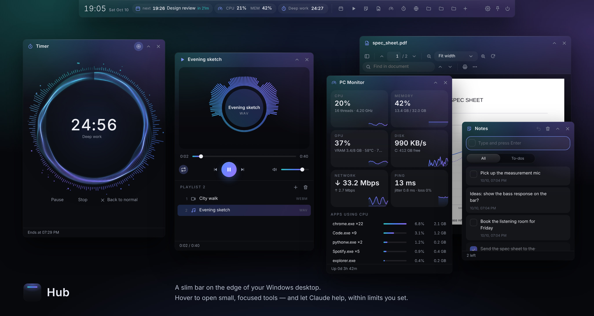
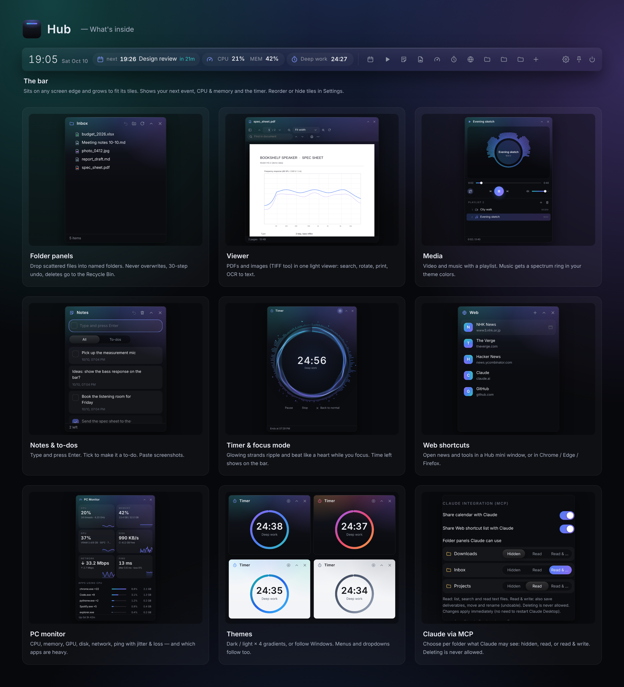

<p align="center"></p>

# Hub

<p align="center"><b>English</b> · <a href="README.ja.md">日本語</a></p>

A slim bar that lives on the edge of your Windows desktop. Hover over it to expand, then open small panels:
sort files into folder panels, view PDFs and images, play videos and music, jot notes and to-dos, run a focus timer, open your favorite sites,
watch your PC's load and see your next calendar event — without switching apps.
Claude can use it too, through MCP, within the limits you set.



> License: [PolyForm Noncommercial 1.0.0](LICENSE) — free for personal and other non-commercial use.

## Features




| Feature | What it does |
|---|---|
| **Folder panels** | Drop scattered desktop files into named folder panels. Never overwrites, undo up to 30 steps, deletes go to the Recycle Bin |
| **Viewer** | PDFs **and images** (PNG / JPEG / GIF / WebP / BMP / **TIFF**, multi-page too) in one light viewer: thumbnails, zoom, rotate, search, **print**, browse the photos in a folder with ← →. Can be set as "Open with". Extras: text via OCR, PDF to images (PNG / JPEG / TIFF G4) |
| **Media** | Videos and music with a playlist (drop files or a whole folder). Music gets a spectrum ring in your theme colors. Formats WebView2 can't play (AVI, WMV, WMA, …) can be converted with **your own** ffmpeg |
| **Notes** | One box for notes and to-dos: type and press Enter, tick ☐ to make it a to-do. Paste screenshots with Ctrl+V |
| **Timer** | One-click 5 / 15 / 25 / 50 min (or any length). The time left shows on the bar, with a soft chime at the end. **Focus mode** turns the ring into particles that ripple and beat like a heart |
| **Web** | Shortcuts to sites you follow (news, …). Open each in a Hub mini window or in Chrome / Edge (address-bar-free app window) / Firefox / your default browser |
| **PC Monitor** | CPU, memory, NVIDIA GPU (usage, VRAM, temperature), disk, network traffic, ping with jitter and loss, and which apps are heavy. CPU & memory can go on the bar |
| **Calendar** | Reads Google / Outlook.com / iCloud calendars via an iCal URL and shows `next 14:00 Standup · in 12m` on the bar (read-only) |
| **Claude integration (MCP)** | Ask Claude things like "Summarize the files in Inbox and save a report to Outbox" or "What's on tomorrow?". You choose which folder panels it can see |
| **Themes** | Dark / Light × 4 gradients (Aurora, Ocean, Ember, Graphite), or follow Windows. Menus and dropdowns follow the theme too |
| **Settings** | Language, theme, bar position (top / bottom / left / right), corners, folder location — all from the UI |
| **English & Japanese** | Follows your Windows language, or pick one in Settings |

## Getting started

1. Install **Python 3.10+** from [python.org](https://www.python.org/downloads/) (check "Add python.exe to PATH").
2. Put this `hub` folder anywhere, open a Command Prompt inside it, and run (no admin rights needed):
   ```bat
   py -m pip install --user -r requirements.txt
   ```
3. Double-click `start_hub.bat` **once**, then turn on Settings (⚙) → Startup → "Add Hub to the Start menu" so you can open Hub like any other app.

No config file is needed. On first launch Hub creates **`Hub\Inbox`** in your user folder (e.g. `C:\Users\you\Hub\Inbox`)
and shows it on the bar. You can change the location in **Settings (⚙ on the bar)**.
On startup, a glowing line stretches along the screen edge and opens into the bar (you can turn this off).

| To… | Do this |
|---|---|
| Start | `start_hub.bat` (no console window) |
| Troubleshoot | Start with `start_hub_debug.bat` to see errors. They're also logged to `%LOCALAPPDATA%\Hub\data\hub.log` |
| Quit | ⏻ at the end of the bar |
| Start with Windows | Settings (⚙) → Startup → "Open Hub when Windows starts" |
| App icon | Settings (⚙) → Startup → "Add Hub to the Start menu" / "Put a Hub icon on the desktop". From the Start menu you can also pin Hub to the taskbar. No need to open the `.bat` again |

## Using Hub

**The bar**
- Hover over the glowing line at the screen edge to expand; move away to collapse. 📌 keeps it expanded —
  a pinned bar sits **behind** other windows (like a desktop widget), so it never covers your work.
- Drag the clock to slide the bar along the edge (the position is remembered).
- The bar grows to fit its tiles (up to the screen width). Reorder or hide tiles in **Settings → Bar tiles** (drag the ⋮⋮ handle; the eye shows/hides).
- Folder panels on the bar (Settings → Bar tiles): **Favorites only** (default — hidden folders open from the Folders tile), **Show all**, or **One tile**.
- When space runs out, tiles switch to icons only (hover for names).
- **Hub picks up where you left off**: open panels, their position and size, collapsed state, bar position and 📌 are restored on next launch.
  Panels left on a disconnected monitor are moved back into view.

**Folder panels** (click a folder on the bar to open/close it, ＋ to add one)

| Action | How |
|---|---|
| Import (move) | Drop files from File Explorer or the desktop. Drop on a folder row to put them inside |
| Open | Double-click |
| Move to another panel | Right-click → Move to |
| Undo | ↶ in the title bar (last 30 moves) |
| Rename / delete | Right-click, or F2 / Delete (deletes go to the Recycle Bin) |

**Viewer**
Open Viewer on the bar and drop a PDF or image (or pick one / reopen from Recent). Each file opens in its own window.
Turn on "Let Hub open PDFs and images" in the Viewer panel to add Hub to the Explorer "Open with" menu (no admin rights).
Shortcuts: Ctrl+F search (PDF) · Ctrl+P print · Ctrl+wheel / Ctrl+± zoom · Ctrl+0 fit · ← → previous / next image · double-click 100% ⇄ fit.
"Save as text" uses the built-in Windows OCR for scanned pages (install the OCR language from Windows Settings → Language if needed).

**Media**
Drop videos, music or a folder. Space play/pause · ← → seek 5 s · ↑ ↓ volume · N / P next / previous · F full screen.
ffmpeg is **not bundled** (it is GPL). If you have it, Hub finds `ffmpeg.exe` on PATH, in `C:\ffmpeg\bin`, or in an unzipped `ffmpeg-*` folder in your user folder / Downloads;
or set `modules.media.ffmpeg` in the config file. Converted files are saved next to the original (the original is kept).

**Web / PC Monitor**
Web: ＋ to add a site; right-click to edit, reorder or delete. Mini-window sign-ins are kept inside Hub, and downloads ask where to save. For busy sites (GitHub and so on), choose "Chrome / Edge (app window)" — uploads, extensions and your browser sign-ins all work there.
PC Monitor measures only while its panel is visible. "Network" is live traffic, not a speed test.

**Notes / Timer**
Notes: Enter adds, Shift+Enter makes a new line, double-click to edit, ↶ restores the last delete.
Timer: keeps running when the panel is closed or Hub restarts. The **Focus mode** button turns the ring into glowing strands with a spectrum and heartbeat (Esc to go back).

**Calendar**
Open 📅 on the bar and paste a URL into "Add iCal URL".
In Google Calendar it's Settings → your calendar → "Secret address in iCal format".
Anyone with this URL can read your events, so keep it private.

## Claude integration (MCP)

Let Claude Desktop (and other Claude apps) use your Hub calendar and folder panels.
For example: "Summarize the meeting notes in Inbox and save them to Outbox as report.md", "What's on tomorrow?"

1. `mcp` is installed with `requirements.txt`.
2. In **Settings (⚙) → Claude integration**, choose which folder panels to share (see below).
3. Click "Copy" on the same screen, paste it into `claude_desktop_config.json`
   (Claude Desktop → Settings → Developer → Edit Config), then restart Claude Desktop.

You choose the access level per folder panel. **By default, nothing is shared.** Changes apply immediately — no need to restart Claude Desktop.

| Access | What Claude can do |
|---|---|
| Hidden (default) | Can't even see that the panel exists |
| Read | List, search by name, and read text files (md / txt / csv / json / html, …) and **PDFs** (text layer; scanned pages are reported so you can OCR them first) |
| Read & write | All of the above, plus **save deliverables** (text, UTF-8, up to 5 MB), move, rename, create folders, undo |

- If a file with the same name exists, Hub saves as `name (2).md`. When asked to overwrite, it sends the old file **to the Recycle Bin first** (recoverable).
- **Deleting is never allowed**, at any level. Files outside the folder panels are never touched.
- The calendar can be shared or hidden with "Share calendar with Claude" (on by default).
- Your Web shortcut list (names and URLs only) can be shared or hidden the same way (on by default). Hub never fetches the pages for Claude.

> 💡 Suggested setup: put files to process in `Inbox` (Read), and let Claude write results to `Outbox` (Read & write).

> ⚠️ Hub itself runs entirely on your PC, but when Claude uses these tools, **event titles, file names and the text you let it read are sent to Claude**.
> The MCP server works even when the Hub bar isn't running.

## Updating

**Just replace the `hub` folder with the new version.** Your settings, data and added modules live outside the app folder, so nothing is lost.

| What | Where (Windows) |
|---|---|
| The app (safe to replace) | the `hub` folder, wherever you put it |
| Settings, data, added modules | `%LOCALAPPDATA%\Hub\` (e.g. `C:\Users\you\AppData\Local\Hub`) |
| Folder panel contents | `~/Hub` (or the location you chose) |

- Versions up to 0.4 kept settings and data inside the app folder. On first launch, newer versions move them to `%LOCALAPPDATA%\Hub` automatically (the old file is kept as `hub.config.json.migrated`).
- When the config format changes, Hub upgrades it on startup (`configVersion`).
- See [CHANGELOG.md](CHANGELOG.md) for what changed. Settings → About shows your current version.

## Config file (optional)

Changes made in Settings are saved to `%LOCALAPPDATA%\Hub\hub.config.json` (created when needed). You can also edit it by hand.

| Key | Values | Default |
|---|---|---|
| `lang` | `auto` / `ja` / `en` | `auto` (follows Windows) |
| `appearance.mode` | `dark` / `light` / `auto` | `dark` |
| `appearance.accent` | `aurora` / `ocean` / `ember` / `graphite` | `aurora` |
| `bar.dock` | `top` / `bottom` / `left` / `right` | `top` |
| `bar.labels` | `auto` / `icons` / `full` | `auto` |
| `bar.length` | `"auto"` (fit the tiles) or a fixed length in px | `"auto"` |
| `bar.tiles` | `{"order": [...], "hidden": [...]}` tile ids such as `"web"`, `"folders:Inbox"` (set in Settings) | `{}` |
| `bar.intro` | startup animation | `true` |
| `windows.corners` | `round` / `small` / `square` (Windows 11) | `round` |
| `modules.folders.root` | where folder panels live | `~/Hub` |
| `modules.calendar.urls` | list of iCal URLs | `[]` |
| `mcp.panels` | folder panels shared with Claude (e.g. `{"Inbox": "read", "Outbox": "write"}`) | `{}` (none) |
| `mcp.calendar` | share the calendar with Claude | `true` |
| `mcp.web` | share the Web shortcut list with Claude | `true` |
| `modules.media.ffmpeg` | path to your `ffmpeg.exe` (only for converting) | found automatically |

## Project layout

```
hub/
├─ hub.py                 entry point (--dev: no windows, preview in a browser)
├─ hub_mcp.py             Claude integration (MCP server)
├─ assets/                logo (hub.svg) and icon (hub.ico); regenerate with tools/make_icons.py
├─ host/                  core: windows, settings, storage, module loading, UI bridge
│   ├─ version.py         VERSION and MODULE_API (the module contract version)
│   └─ paths.py           where the app and user data live
├─ ui/                    shared bar and panel UI (HTML/CSS/JS); strings in ui/js/i18n.js
├─ modules/               ★ one folder per tool
│   ├─ folders/  pdf/ (Viewer)  media/  notes/  timer/  web/  system/  calendar/  settings/
└─ tests/                 automated tests
(settings, data and added modules live in %LOCALAPPDATA%\Hub\)
```

## Adding tools (modules)

Create a folder with a `manifest.json` in `%LOCALAPPDATA%\Hub\modules\` and a tile appears on the bar
(bundled modules live in the app's `modules/`; yours live on the user side so updates don't remove them).

- **L1 (just run an existing command)**: describe accepted file types, the command and input fields under `actions` in `manifest.json` — Hub builds the UI. Example: the "Save as images" action in `modules/pdf/manifest.json`.
- **L2 (runs inside Hub)**: write `api.py` (Python functions) and `ui/panel.js` (UI). Only functions listed under `exports` in `manifest.json` can be called from the UI. Example: `modules/folders/`.
- Show live status on the bar with `hub.status` (e.g. the calendar's `next`); add English strings under `locales.en`.
- Declare compatible Hub versions with `"requires": { "hub": ">=0.6", "moduleApi": 1 }`. Incompatible modules are skipped with a ⚠ on the bar (others keep working).

## Security

- The UI talks to Python only on this PC (127.0.0.1), with a token generated at every launch; unknown callers are rejected.
- Folder panels can't touch files outside their configured location. Moves never overwrite; deletes go to the Recycle Bin.
- The calendar is read-only. If it can't sync, the last fetched events are shown.

## Development

```bat
py -m unittest discover -s tests -v
py hub.py --dev        :: open the printed URL in a browser to preview the UI
```

## License

**[PolyForm Noncommercial 1.0.0](LICENSE)** — free to use, read, modify and share for **personal, study, research and other non-commercial purposes**.
Commercial use (selling it, bundling it in a paid product or service, using it in for-profit work) is not permitted. For commercial use, please contact the author.

Third-party libraries (each under its own license):

| Library | Used for | License |
|---|---|---|
| pywebview | windows (WebView2) | BSD-3-Clause |
| Send2Trash | Recycle Bin | BSD-3-Clause |
| PDF.js | PDF viewer (bundled in `modules/pdf/ui/vendor/pdfjs`) | Apache-2.0 |
| PyMuPDF | PDF to image / text | **AGPL-3.0** (not bundled; installed separately via pip) |
| Pillow | image output | MIT-CMU |
| icalendar / python-dateutil | calendar | BSD-2-Clause / Apache-2.0 & BSD |
| mcp | Claude integration | MIT |
| psutil | PC Monitor | BSD-3-Clause |
| ffmpeg | converting media (optional, **not bundled**; uses the copy you installed) | LGPL / GPL (depending on the build) |

The logo and icons (`assets/`) are covered by the same license.
